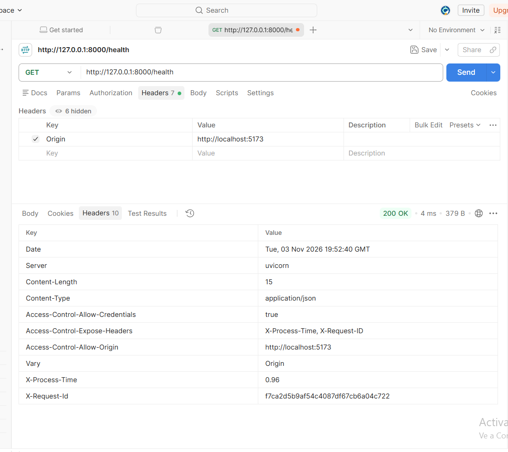
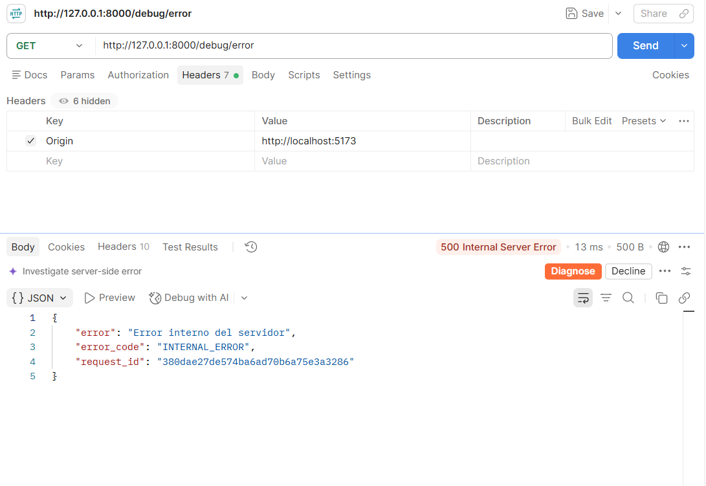
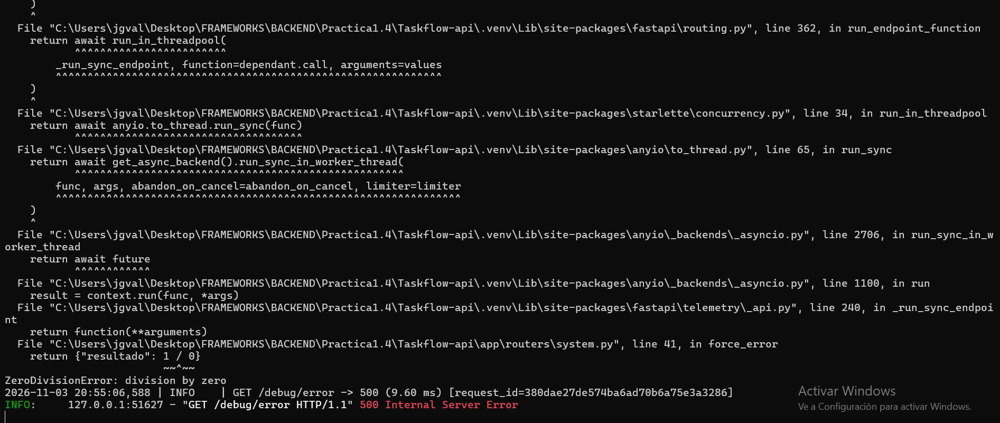

# Práctica 1.4 – Middleware

## Objetivo

Añadir a la API comportamiento transversal, es decir, código que se aplica a **todas** las peticiones sin repetirlo en cada endpoint: CORS, tiempo de respuesta y manejo global de errores.

## Archivos nuevos o modificados

```
app/
├── main.py              # registra middlewares y handlers (sigue sin rutas de negocio)
├── core/
│   ├── config.py        # + ENVIRONMENT y configuración CORS
│   ├── logging.py       # NUEVO: logger "taskflow"
│   ├── middleware.py    # NUEVO: CORS, X-Process-Time, X-Request-ID, captura de errores
│   └── errors.py        # + handler global 500 y formato de error común
├── routers/system.py    # + GET /debug/error para forzar una excepción
└── schemas/common.py    # ErrorResponse con error / error_code / request_id
```

## 1. ¿Qué es un middleware?

Un middleware es una capa que envuelve a la aplicación. Cada petición pasa por él **antes** de llegar al endpoint y la respuesta vuelve a pasar **después**. Sirve para lo que es común a todas las rutas: seguridad, logs, cabeceras, errores… Así no hay que copiar ese código en cada endpoint.

Cuando hay varios, se ejecutan como capas de una cebolla: la petición entra de fuera hacia dentro y la respuesta sale de dentro hacia fuera.

## 2. Orden de los middlewares

```
Petición  ─►  request_context  ─►  CORS  ─►  catch_exceptions  ─►  endpoint
Respuesta ◄─  (tiempo, id, log) ◄─       ◄─  (error → 500)      ◄─
```

En Starlette, **el último middleware que se añade es el más externo**. Por eso en `register_middlewares()` se añaden al revés.

| Capa | Por qué va ahí |
|---|---|
| `request_context` (la más externa) | Mide el tiempo **total** y escribe en el log **todas** las respuestas: también los preflight de CORS y los errores 500. Si estuviera por dentro del manejo de errores, una excepción le pasaría por encima y esa petición se quedaría sin `X-Process-Time` y sin línea en el log. Por eso **el logger va antes que el handler de errores**. |
| `CORS` (en medio) | Así también las respuestas de error llevan las cabeceras CORS. Si no las llevaran, el navegador mostraría un "error de CORS" y ocultaría el error real. |
| `catch_exceptions` (la más interna) | Convierte la excepción en una respuesta 500 en cuanto sale del endpoint. Así las capas de fuera reciben una respuesta normal a la que pueden añadir sus cabeceras. |

## 3. CORS

**Problema que resuelve:** el navegador bloquea las peticiones de una web (por ejemplo, el frontend de Vite en `http://localhost:5173`) a otro origen (la API en `http://127.0.0.1:8000`), salvo que la API lo permita expresamente con cabeceras CORS.

```python
app.add_middleware(
    CORSMiddleware,
    allow_origins=CORS_ORIGINS,          # ["http://localhost:5173", "http://127.0.0.1:5173"]
    allow_credentials=True,
    allow_methods=CORS_METHODS,          # GET, POST, PUT, PATCH, DELETE, OPTIONS
    allow_headers=CORS_HEADERS,          # Content-Type, Authorization, X-Request-ID
    expose_headers=CORS_EXPOSE_HEADERS,  # X-Process-Time, X-Request-ID
)
```

- **Orígenes por entorno:** en desarrollo se permite el frontend de Vite. En producción no hay ningún origen por defecto, así que hay que indicarlo con la variable de entorno `CORS_ORIGINS`. No uso `"*"` porque permitiría que cualquier web llamara a la API desde el navegador de un usuario.
  ```bat
  set ENVIRONMENT=production
  set CORS_ORIGINS=https://taskflow.midominio.com
  ```
- **Métodos y cabeceras concretos** en lugar de `"*"`: solo se permite lo que la API usa de verdad.
- **`expose_headers`:** por seguridad, el navegador solo deja que el JavaScript lea unas pocas cabeceras básicas. Para que el frontend pueda leer `X-Process-Time` y `X-Request-ID` (por ejemplo, para mostrar el id cuando falla algo) hay que exponerlas explícitamente.

Si un origen no permitido (por ejemplo, `http://evil.com`) hace una petición, la respuesta no lleva `Access-Control-Allow-Origin` y el navegador la bloquea.

## 4. Middleware propio: `X-Process-Time` y `X-Request-ID`

**Problema que resuelve:** saber cuánto tarda cada petición y poder seguirla en los logs.

```python
start = time.perf_counter()
response = await call_next(request)
process_time_ms = (time.perf_counter() - start) * 1000
response.headers["X-Process-Time"] = f"{process_time_ms:.2f}"   # en milisegundos
response.headers["X-Request-ID"] = request_id
```

- **`X-Process-Time`:** el tiempo de respuesta en ms. Uso `time.perf_counter()` porque es el reloj pensado para medir duraciones (más preciso que `time.time()`). Aparece en **todas** las respuestas: 200, 201, 404, 422, 500 y preflight OPTIONS.
- **`X-Request-ID`:** un identificador único por petición. Si el cliente ya manda uno, se reutiliza; si no, se genera con `uuid4`. Va en la respuesta, en el log y en el cuerpo de los errores, así que si un usuario dice "me ha salido un error con id `362da7…`", se encuentra al momento en el log.
- Además escribe **una línea de log por petición**:
  ```
  2026-11-03 19:45:42 | INFO    | GET /health -> 200 (4.06 ms) [request_id=242b6540...]
  ```

## 5. Manejo global de excepciones

**Problema que resuelve:** que un error de programación en un endpoint no tumbe la API ni le enseñe al cliente información interna.

Toda la API usa el mismo formato de error (`ErrorResponse`):

```json
{ "error": "mensaje para el cliente", "error_code": "CODIGO", "request_id": "..." }
```

| Caso | Código HTTP | `error_code` |
|---|---|---|
| Excepción no controlada | 500 | `INTERNAL_ERROR` |
| Datos no válidos | 422 | `VALIDATION_ERROR` (y además `errors` con el detalle por campo) |
| Ruta inexistente / método no permitido | 404 / 405 | `NOT_FOUND` / `METHOD_NOT_ALLOWED` |

`error_code` es un código fijo que el frontend puede comprobar con un `if`, sin depender del texto del mensaje, que puede cambiar.

### Seguridad: el stacktrace nunca llega al cliente

El handler global (`unhandled_exception_handler`) hace dos cosas distintas:

- **En el log:** guarda el error **completo**, con el stacktrace, usando `logger.exception(...)`, para poder depurarlo.
- **Al cliente:** le envía solo un mensaje **genérico**: `"Error interno del servidor"`. El stacktrace revela rutas de archivos, librerías, versiones y lógica interna, y todo eso le sirve a un atacante.

Se registra en dos sitios: en `catch_exceptions_middleware` (el camino normal) y con `app.add_exception_handler(Exception, ...)` como red de seguridad, por si una excepción saltara fuera de los middlewares.

### Prueba: excepción forzada

`GET /debug/error` hace una división entre cero a propósito. Solo está disponible en desarrollo, y en producción ni siquiera aparece en `/docs`.

Respuesta (500):

```json
{ "error": "Error interno del servidor", "error_code": "INTERNAL_ERROR", "request_id": "362da7cd6e124cfcb71160f63c9955c4" }
```

En la consola de uvicorn se ve el error completo (`ZeroDivisionError: division by zero` con el stacktrace) y **el servidor sigue funcionando**: después, `GET /ping` responde normal.

## 6. Capturas

### Cabeceras en una respuesta normal (`GET /health`)

Se ven `x-process-time` y `x-request-id`. Si la petición se hace con la cabecera `Origin: http://localhost:5173` (en Postman), aparecen también `access-control-allow-origin` y `access-control-expose-headers`.



### Excepción forzada (`GET /debug/error`)

Respuesta 500 sin stacktrace, también con `x-process-time`.



### Log del servidor

El stacktrace completo solo aparece en la consola.



## Arrancar

```bat
.\.venv\Scripts\activate.bat
pip install -r requirements.txt
uvicorn app.main:app --reload
```
